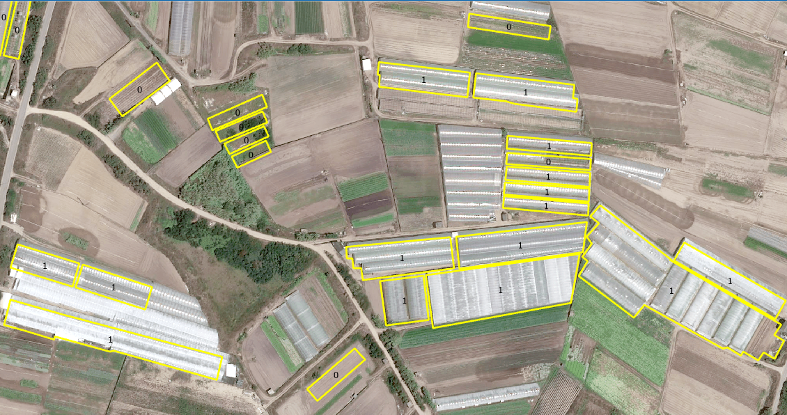
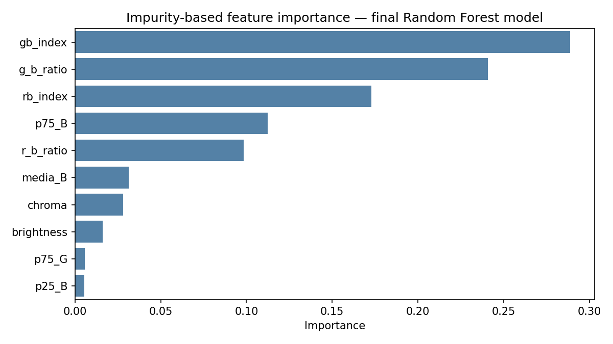
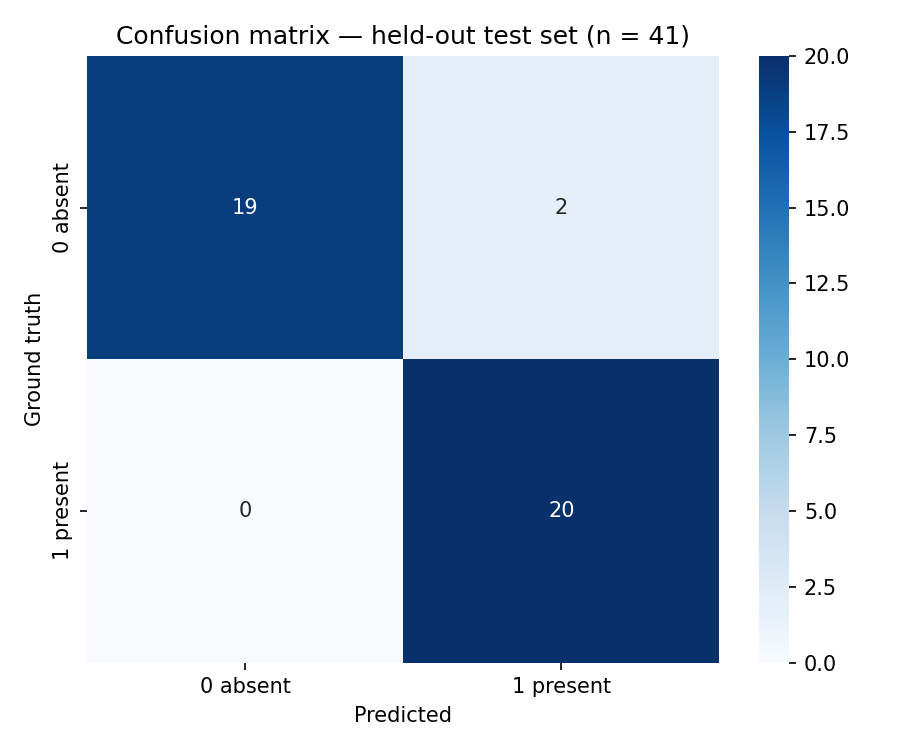

[English](README.md) · **Português**

# Verificação de um cadastro de estufas com aprendizagem automática
### Validação automática de estufas registadas em SIG com imagem recente · Zona Vulnerável de Esposende–Vila do Conde, Portugal

> Aprendizagem automática clássica (Random Forest / Gradient Boosting)
> sobre características espectrais, texturais e geométricas extraídas de
> ortoimagem RGB, para verificar, polígono a polígono, se as estufas
> registadas numa plataforma SIG desde 2013 ainda existem no terreno — com
> uma probabilidade associada a cada decisão, usada para orientar a
> verificação de campo.

---

*Polígonos do cadastro classificados pelo modelo sobre a ortoimagem ortoSat2023 da DGT — estufa presente (1); já não existe (0).*


*Importância das características (baseada na impureza) no modelo final Random Forest (10 características selecionadas).*


*Conjunto de teste independente: 39 de 41 polígonos corretamente classificados.*

## Porquê verificar

Desde 2013, as equipas de monitorização da Zona Vulnerável de
Esposende–Vila do Conde (ZV1) foram cartografando polígonos de estufas numa
plataforma SIG dedicada (SIA-ZV), com base em entrevistas aos agricultores.
No entanto, o cadastro nunca foi atualizado de forma sistemática, nem no
terreno nem em gabinete, por ser um trabalho moroso e dispendioso. Uma
década depois, o cadastro e o território tinham divergido visivelmente:
estruturas demolidas, substituídas, ampliadas ou construídas de novo.

Um cadastro desatualizado compromete tudo o que dele depende: o mapeamento
de pressões, a verificação do cumprimento das normas e o cruzamento com os
dados de monitorização de nitratos. Mas revisitar manualmente centenas de
polígonos era precisamente o custo que a instituição não podia suportar.
Era necessário um método automático para verificar, de forma eficiente, se
cada estufa registada ainda existe.

## A abordagem

Para cada polígono registado, o *pipeline* — `verify_greenhouses.py` —
extrai uma assinatura estatística da ortoimagem RGB recente de alta
resolução e treina um classificador binário para decidir: *ainda existe
aqui uma estufa?*

### 1. Engenharia de características

Só são usados os pixéis dentro do polígono: os pixéis exteriores, os
valores *nodata* e o preenchimento a preto são mascarados. Os polígonos
fora da imagem, ou com menos de 20 pixéis válidos, são assinalados como sem
dados. Trabalhando apenas com RGB (sem banda de infravermelho próximo), o
script calcula **34 características candidatas por polígono**:

- **Estatísticas por banda** (12) — média, desvio-padrão e percentis 25 e
  75 de R, G e B;
- **Textura** (3) — diferença absoluta média entre pixéis vizinhos na
  horizontal e na vertical, por banda (as coberturas das estufas são
  localmente lisas, mas com estrutura regular);
- **Entropia** (3) — entropia de Shannon de um histograma de 32 classes
  sobre toda a amplitude radiométrica, por banda;
- **Índices de vegetação RGB** (4) — Excess Green (ExG), Excess Green menos
  Excess Red (ExGR), VARI (mediana por pixel, com denominadores próximos de
  zero mascarados) e a diferença normalizada G–R: substitutos habituais do
  NDVI quando não há banda NIR;
- **Descritores de cor** (8) — diferenças normalizadas G–B e R–B, brilho,
  croma (máximo − mínimo das três bandas), canal dominante e as razões R/G,
  R/B e G/B entre as médias das bandas;
- **Geometria** (4) — área, perímetro, compacidade (4πA/P²) e razão
  perímetro/área.

As características geométricas exigem um sistema de coordenadas projetado
em metros (por exemplo, PT-TM06/ETRS89, EPSG:3763); o script termina com
erro se o sistema for geográfico.

### 2. *Pipeline* de treino sem fuga de dados

Os polígonos rotulados são primeiro divididos, de forma estratificada por
classe, num conjunto de treino (75 %) e num conjunto de teste independente
(25 %). Todos os passos seguintes são ajustados apenas com os dados de
treino, num único *pipeline* do `imbalanced-learn`, que é reajustado dentro
de cada partição da validação cruzada:

1. **Imputação KNN** (5 vizinhos) dos valores em falta;
2. **Escalamento robusto** (mediana/amplitude interquartil), insensível aos
   valores extremos que as estatísticas espectrais inevitavelmente
   produzem;
3. **Seleção de características** — mantêm-se as características cuja
   importância num Random Forest excede a importância média;
4. **Sobreamostragem SMOTE** da classe minoritária, ativada apenas quando a
   razão minoritária/maioritária no treino é inferior a 0,7 (limiar
   heurístico). As amostras sintéticas são geradas apenas a partir das
   partições de treino. Na execução aqui apresentada as classes rotuladas
   estavam equilibradas (razão 0,98), pelo que o SMOTE não foi ativado;
5. **Classificador.**

### 3. Comparação e afinação de modelos

O Random Forest e o Gradient Boosting são afinados por pesquisa em grelha
com validação cruzada estratificada em 5 partições sobre o conjunto de
treino, avaliada pela **exatidão equilibrada**. O modelo com a melhor
exatidão equilibrada em validação cruzada é selecionado e depois avaliado
**uma única vez** no conjunto de teste, com a exatidão e o respetivo
intervalo de confiança a 95 %, a exatidão equilibrada, a precisão e a
sensibilidade por classe e a AUC-ROC.

### 4. Modelo final e resultados produzidos

Depois da avaliação, o *pipeline* selecionado é reajustado com todos os
polígonos rotulados, mantendo os mesmos hiperparâmetros, e aplicado a todos
os polígonos do cadastro. Cada polígono recebe:

- `Conf_pred` — classe prevista: estufa presente (1) ou ausente (0);
- `Prob_pos` — probabilidade prevista da classe 1. As probabilidades **não
  estão calibradas**: ordenam os polígonos pela confiança do modelo, mas
  não devem ser lidas como frequências exatas;
- `Triagem` — `presente` (`Prob_pos` ≥ 0,7), `ausente` (≤ 0,3),
  `verificar` (valores intermédios: entra na lista curta para verificação
  de campo ou em gabinete) ou `sem_dados` (sem imagem válida);
- `Conjunto` — indica se o polígono foi usado no treino, no teste ou se não
  estava rotulado.

O resultado é gravado como camada FileGDB e como ficheiro GeoJSON (WGS84),
pronto para o processo de atualização do SIA-ZV. Os limiares de triagem são
configuráveis.

## Resultados

A verdade-terreno é composta por **162 polígonos do cadastro** (80 com
estufa presente, 82 ausentes), rotulados por fotointerpretação da
ortoimagem ortoSat2023 em polígonos escolhidos ao percorrer o mapa — uma
amostra de conveniência, não uma amostra aleatória formal. O Random Forest
foi selecionado face ao Gradient Boosting. A seleção manteve **10 das 34**
características candidatas, encabeçadas por `gb_index`, `g_b_ratio`,
`rb_index` e `p75_B`; nenhuma característica geométrica foi retida, pelo
que a decisão assenta apenas na cor. O predomínio das relações com a banda
azul é coerente com a assinatura clara e de baixo croma das coberturas
plásticas, face ao solo nu e à vegetação, que absorvem comparativamente
mais no azul.

| Métrica | Valor |
|---|---|
| Conjunto de teste independente | 41 polígonos (21 ausentes, 20 presentes) |
| Exatidão no teste (IC 95 %, Clopper–Pearson) | **95,1 %** (83,5–99,4 %) |
| Exatidão equilibrada no teste | 95,2 % |
| Classe 0 (estufa ausente) — sensibilidade / precisão | 0,90 / 1,00 |
| AUC-ROC no teste | 1,000 |
| Exatidão equilibrada em validação cruzada (5 partições, treino) | 100 % em todas as partições |
| Polígonos do cadastro avaliados | 1 792 (todos com imagem válida) |

Os dois erros no teste são estufas que já tinham desaparecido mas foram
classificadas como presentes; todos os polígonos classificados como
ausentes estavam de facto ausentes. Uma AUC de 1,0 significa que o modelo
ordenou corretamente todos os polígonos de teste — os dois erros ficam
apenas do lado errado do limiar de decisão de 0,5. Os valores perfeitos da
validação cruzada refletem uma amostra rotulada composta sobretudo por
casos inequívocos e não devem ser lidos como um classificador sem erros; o
intervalo do teste é a medida mais realista.

Aplicado ao cadastro completo, o modelo estima que **1 300 das 1 792
estufas registadas (72,5 %) ainda existem**, ocupando 142,6 dos 178,0 ha
(80 %) — as estruturas que desapareceram são, em média, mais pequenas.
Apenas **98 polígonos (5,5 %)** ficam na faixa de incerteza e são
assinalados para verificação de campo ou em gabinete. Os polígonos
pequenos concentram tanto as perdas como a incerteza:

| Área do polígono | Polígonos | Previstos presentes | Assinalados para verificação |
|---|---|---|---|
| < 500 m² | 556 | 60 % | 10 % |
| 500–2 000 m² | 1 045 | 76 % | 4 % |
| > 2 000 m² | 191 | 90 % | 2 % |

### Limitações

- **A referência é a fotointerpretação, não dados de campo.** Os rótulos
  resultam da interpretação da mesma ortoimagem ortoSat2023 que o modelo
  usa; as métricas medem, por isso, a concordância com um intérprete
  especialista sobre essa imagem, e não com a situação no terreno.
- **Amostra rotulada pequena e não aleatória.** Cerca de metade do conjunto
  rotulado são ausências, enquanto o modelo prevê aproximadamente um quarto
  dos polígonos não rotulados como ausentes: a amostra sobrerrepresenta os
  casos de desaparecimento e os casos inequívocos. As métricas de teste
  descrevem, portanto, a capacidade de separar as classes, e não a
  exatidão sobre todo o cadastro, e variam visivelmente à medida que se
  acrescentam rótulos. Uma amostra aleatória de previsões confiantes,
  verificada de forma independente, daria uma estimativa não enviesada
  para todo o cadastro.
- **Os erros tendem a manter registos obsoletos.** As ausências não
  detetadas (sensibilidade de 0,90 na classe 0) deixam no cadastro estufas
  que já desapareceram; baixar o limiar de decisão ou alargar a faixa
  `verificar` reduz esses casos à custa de mais trabalho de verificação.
- **Presença, não utilização.** O modelo deteta a estrutura da estufa, não
  se está em produção.
- **Uma única data de imagem.** Estruturas temporariamente sem plástico, ou
  em construção, podem ser mal classificadas, e as alterações posteriores à
  data da imagem só são captadas na campanha seguinte.
- **Importâncias indicativas.** As importâncias baseadas na impureza são
  enviesadas entre características correlacionadas (por exemplo, razões e
  diferenças normalizadas entre bandas); a ordenação deve ser lida de
  forma qualitativa.

## Porque é relevante

- **Manutenção do cadastro a uma fração do custo** — em vez de revisitar
  1 792 polígonos, o trabalho de campo concentra-se nos cerca de 100
  assinalados como incertos;
- **Uma auditoria repetível** — o método pode ser corrido em cada nova
  campanha de imagem (por exemplo, em cada nova ortoimagem da DGT),
  transformando a validação do cadastro de um projeto pontual numa rotina;
- **Complementar à deteção** — em conjunto com o projeto de
  [deteção de estufas com U-Net](https://github.com/LFilipePacheco/greenhouse-detection-unet),
  fecha o ciclo: a deteção encontra estruturas que faltam no cadastro; a
  verificação assinala estruturas registadas que já não existem no
  terreno.

## Conteúdo do repositório

| Ficheiro | Finalidade |
|---|---|
| `verify_greenhouses.py` | *Pipeline* completo: extração de características da imagem, pré-processamento e seleção de características sem fuga de dados, comparação e afinação de modelos, avaliação no teste independente, classificação por polígono com probabilidades e triagem |
| `requirements.txt` | Dependências Python |
| `docs/` | Figuras usadas neste README |

## Utilização

Edite o bloco de configuração no início de `verify_greenhouses.py`:

- `poligonos_path` / `poligonos_layer` — a camada de polígonos do cadastro;
- `campo_alvo` — o campo de verdade-terreno (`1` presente, `0` ausente,
  vazio se não rotulado; por omissão `Conf_novo`);
- `raster_path` — a ortoimagem RGB (bandas 1–3 = R, G, B);
- `output_gdb`, `output_layer`, `output_dir` — localização dos resultados.

Depois execute:

```bash
pip install -r requirements.txt
python verify_greenhouses.py
```

A pasta de resultados contém a camada de saída (GeoJSON), um relatório de
texto com todas as métricas e os hiperparâmetros selecionados, e as
figuras de correlação, importância das características e matriz de
confusão. A gravação em FileGDB requer GDAL ≥ 3.6.

## Tecnologias

Python · NumPy · pandas · scikit-learn · imbalanced-learn · SciPy ·
GeoPandas · Shapely · rasterio · Matplotlib · seaborn · ortoimagem
ortoSat2023 (WMS aberto, Direção-Geral do Território)

## Sobre os dados

O cadastro de estufas (SIA-ZV), os rótulos de verdade-terreno e os
resultados da verificação são propriedade institucional da CCDR-Norte, I.P.
e não são publicados aqui. A imagem é o serviço aberto ortoSat2023 da
Direção-Geral do Território (DGT). O código é partilhado como
implementação de referência funcional.

---

**Luís Filipe Pacheco** — Engenheiro Sénior e Cientista de Dados,
CCDR-Norte, I.P. · [Perfil GitHub](https://github.com/LFilipePacheco) ·
[LinkedIn](https://www.linkedin.com/in/lu%C3%ADs-filipe-pacheco-471495b/) ·
[ORCID](https://orcid.org/0009-0001-7676-6542)
